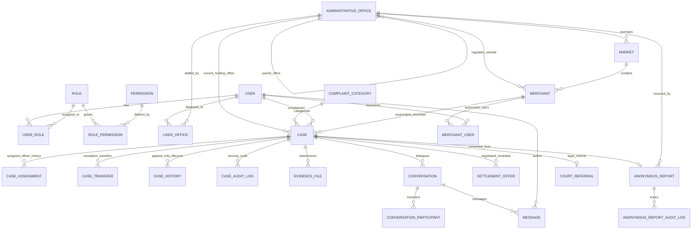

# Database Architecture & Domain Model: Addis Ababa Consumer Rights Protection Platform
### የአዲስ አበባ ሸማቾች መብት ጥበቃ መድረክ

> **Document Version:** 3.0 (Dual Routing & Contract Reconciliation Baseline)
> **Platform Scope:** Independent Consumer Rights Protection Platform for the Addis Ababa Bureau of Trade and Market Development, Ethiopia
> **Target Database Engine:** PostgreSQL 16+
> **ORM Specification:** Prisma ORM 5.x / 6.x / 7.x compatible
> **Shared Contracts:** `@consumer-rights/contracts` (`lib/contracts`)

---

## 1. Executive Summary & Reconciliation Baseline

This document reconciles the relational database architecture with the confirmed **Dual Routing** model and the shared contract specifications (`@consumer-rights/contracts`).

### Core Architecture Principles:
1. **Independent System:** The platform maintains its own database, authentication, merchant directory, office hierarchy, and case store. External integrations (such as AddisB2B or Fayda national identity) are treated as decoupled boundary adapters.
2. **Dual Routing Enforced:**
   - **Route A (Direct to Government):** Consumer selects a government level (`woreda`, `subcity`, or `bureau`) and a specific office belonging to that level. Initial government office is assigned at creation (`current_office_id IS NOT NULL`). Respondent merchant is optional: can be an enrolled business (`merchant_id`), an unregistered merchant (`unregistered_merchant_name`), or unspecified. Crucially, Route A is held immediately in government custody and never initiates bilateral business negotiation.
   - **Route B (Registered Business):** Consumer selects an enrolled business (`merchant_id IS NOT NULL`). Government office is initially unset (`current_office_id IS NULL`). Unregistered merchant fields are forbidden. The merchant negotiates directly with the consumer. Escalation to government is a separate workflow preserving full case history.
3. **Privacy Boundary:** The business never sees the consumer's real name, phone, email, or physical address. The database stores the real identity in `users`, but business-facing projections and queries expose only the pseudonymous `complainant_alias` (e.g. `Consumer 00123`).
4. **Append-Only Case History & Audit:** Case lifecycle events, transfers, and officer assignments maintain complete history. Destructive updates and deletions on audit tables are forbidden.
5. **Provisional Reference Standard:** Complaint references use the prototype-aligned provisional format `CC-YYYY-NNNNN` (5 digits). Formal statutory numbering remains subject to final Bureau sign-off.

---

## 2. Reconciled Domain Entity Relationship Diagram



---

## 3. Entity Specifications & Field Mappings

### 3.1 Domain 1: Identity, Authentication & Roles

#### `users`
Represents individuals across all portals (Citizens, Business Owners/Staff, Government Officers, System Admins).
- `id`: `UUID` (PK, default `gen_random_uuid()`)
- `phone_number`: `VARCHAR(20)` (UNIQUE, NOT NULL, E.164 format)
- `full_name`: `VARCHAR(128)` (NOT NULL)
- `email`: `VARCHAR(255)` (UNIQUE, NULLABLE)
- `password_hash`: `VARCHAR(255)` (NOT NULL)
- `national_id_fayda`: `VARCHAR(64)` (UNIQUE, NULLABLE - placeholder for future phase)
- `status`: `VARCHAR(32)` (DEFAULT `'ACTIVE'`: `ACTIVE`, `SUSPENDED`, `DEACTIVATED`)
- `preferred_language`: `VARCHAR(8)` (DEFAULT `'am'`: `am`, `en`)
- `created_at`, `updated_at`: `TIMESTAMPTZ`

#### `roles` & `permissions`
- `roles`: `id`, `code` (`VARCHAR(32)` UNIQUE: `consumer`, `business_owner`, `woreda_officer`, `woreda_admin`, `subcity_coordinator`, `bureau_officer`, `bureau_admin`, `content_admin`), `name`, `description`.
- `permissions`: `id`, `code` (`VARCHAR(64)` UNIQUE: e.g. `complaints.read.own`, `cases.assign.woreda`), `module`, `action`, `scope`.
- `user_roles`: `user_id`, `role_id`, `created_at` (`PRIMARY KEY (user_id, role_id)`).
- `role_permissions`: `role_id`, `permission_id`, `created_at` (`PRIMARY KEY (role_id, permission_id)`).

#### `user_offices`
Tracks government officer assignments to specific administrative jurisdictions.
- `id`: `UUID` (PK)
- `user_id`: `UUID` (FK $\rightarrow$ `users.id`)
- `office_id`: `UUID` (FK $\rightarrow$ `administrative_offices.id`)
- `role_in_office`: `VARCHAR(64)` (e.g. `'INVESTIGATING_OFFICER'`, `'DESK_ADMIN'`)
- `is_active`: `BOOLEAN` (DEFAULT `TRUE`)
- `assigned_at`: `TIMESTAMPTZ` (DEFAULT `NOW()`)
- `unassigned_at`: `TIMESTAMPTZ` (NULLABLE)
- *Integrity constraint:* Partial unique index ensuring at most one active deployment per user:
  ```sql
  CREATE UNIQUE INDEX idx_user_single_active_office ON user_offices (user_id) WHERE is_active = TRUE;
  ```

---

### 3.2 Domain 2: Administrative Structure & Markets

#### `administrative_offices`
Hierarchical municipal trade office registry (Addis Ababa City Bureau $\rightarrow$ 11 Sub-Cities $\rightarrow$ Woreda Trade Offices).
- `id`: `UUID` (PK)
- `code`: `VARCHAR(32)` (UNIQUE, e.g. `'OFF-BUREAU'`, `'OFF-AKAKI-KALITY'`, `'OFF-AKAKI-W07'`)
- `name_en`: `VARCHAR(128)` (NOT NULL)
- `name_am`: `VARCHAR(128)` (NOT NULL)
- `level`: `VARCHAR(16)` (NOT NULL: `'bureau'`, `'subcity'`, `'woreda'`)
- `parent_office_id`: `UUID` (NULLABLE, FK $\rightarrow$ `administrative_offices.id`)
- `subcity_code`: `VARCHAR(32)` (NULLABLE, e.g. `'AKAKI_KALITY'`)
- `woreda_code`: `VARCHAR(32)` (NULLABLE, e.g. `'W07'`)
- `address`: `VARCHAR(255)` (NOT NULL)
- `phone`: `VARCHAR(32)` (NOT NULL)
- `email`: `VARCHAR(255)` (NULLABLE)
- `is_active`: `BOOLEAN` (DEFAULT `TRUE`)
- *Hierarchy constraint:*
  - Bureau has `parent_office_id IS NULL`.
  - Sub-City has `parent_office_id` referencing the Bureau.
  - Woreda has `parent_office_id` referencing its Sub-City.

#### `markets`
Public market centers under municipal trade oversight.
- `id`: `UUID` (PK)
- `code`: `VARCHAR(32)` (UNIQUE, e.g. `'MKT-097'`)
- `name_en`: `VARCHAR(128)` (NOT NULL)
- `name_am`: `VARCHAR(128)` (NOT NULL, e.g. `'ቃሊቲ ገብርኤል ገበያ'`)
- `woreda_office_id`: `UUID` (FK $\rightarrow$ `administrative_offices.id`)
- `subcity_code`: `VARCHAR(32)` (NOT NULL)
- `location_description`: `VARCHAR(255)` (NOT NULL)
- `is_active`: `BOOLEAN` (DEFAULT `TRUE`)

#### `merchants` & `merchant_users`
Registered business entities enrolled in the platform directory.
- `merchants`: `id`, `registration_number` (UNIQUE), `trade_name` (NOT NULL), `legal_name` (NOT NULL), `business_category` (NOT NULL), `market_id` (NULLABLE, FK $\rightarrow$ `markets.id`), `stall_number` (NULLABLE), `woreda_office_id` (FK $\rightarrow$ `administrative_offices.id`), `phone_number` (NOT NULL), `is_active` (BOOLEAN).
- `merchant_users`: `id`, `merchant_id` (FK $\rightarrow$ `merchants.id`), `user_id` (FK $\rightarrow$ `users.id`), `role_in_business` (`'OWNER'`, `'MANAGER'`), `is_primary_contact` (BOOLEAN). `UNIQUE(merchant_id, user_id)`.

---

### 3.3 Domain 3: Complaints & Dual Routing Engine

#### `complaint_categories`
Configurable list of grievances administered by City Bureau.
- `id`: `UUID` (PK)
- `code`: `VARCHAR(64)` (UNIQUE: `misleading_commercial_practice`, `defective_goods`, `expired_products`, `unsafe_products`, `price_above_ceiling`, `wrong_weight_measure`, `service_complaint`, `other`)
- `name_en`, `name_am`: `VARCHAR(128)` (NOT NULL)
- `default_sla_days`: `INT` (DEFAULT 5)
- `is_active`: `BOOLEAN` (DEFAULT `TRUE`)

#### `cases`
Core complaint records supporting Dual Routing.
- `id`: `UUID` (PK)
- `reference_number`: `VARCHAR(32)` (UNIQUE, format `CC-YYYY-NNNNN`)
- `route`: `VARCHAR(32)` (NOT NULL: `'direct_government'`, `'registered_business'`)
- `complainant_id`: `UUID` (NOT NULL, FK $\rightarrow$ `users.id`)
- `complainant_alias`: `VARCHAR(32)` (NOT NULL, e.g. `'Consumer 00123'`)
- `merchant_id`: `UUID` (NULLABLE, FK $\rightarrow$ `merchants.id`)
- `unregistered_merchant_name`: `VARCHAR(128)` (NULLABLE)
- `unregistered_merchant_location`: `VARCHAR(255)` (NULLABLE)
- `unregistered_merchant_phone`: `VARCHAR(32)` (NULLABLE)
- `market_id`: `UUID` (NULLABLE, FK $\rightarrow$ `markets.id`)
- `category_id`: `UUID` (NOT NULL, FK $\rightarrow$ `complaint_categories.id`)
- `incident_date`: `DATE` (NOT NULL)
- `item_description`: `TEXT` (NOT NULL)
- `disputed_amount`: `NUMERIC(12, 2)` (NOT NULL)
- `currency`: `VARCHAR(3)` (DEFAULT `'ETB'`)
- `payment_method`: `VARCHAR(32)` (NULLABLE)
- `receipt_available`: `BOOLEAN` (DEFAULT `TRUE`)
- `desired_remedy`: `VARCHAR(64)` (NOT NULL: `'refund'`, `'replacement'`, `'repair'`, `'other'`)
- `status`: `VARCHAR(32)` (NOT NULL: see Case Status Lifecycle)
- `current_office_id`: `UUID` (NULLABLE, FK $\rightarrow$ `administrative_offices.id`)
- `escalated_to_gov_at`: `TIMESTAMPTZ` (NULLABLE)
- `sla_deadline`: `TIMESTAMPTZ` (NULLABLE)
- `created_at`, `updated_at`: `TIMESTAMPTZ`

#### Route Validation Constraint:

The constraint enforces all merchant-identification combinations.
PostgreSQL evaluates `NULL = value` as UNKNOWN (not TRUE), so `merchant_id IS NOT NULL`
and `unregistered_merchant_name IS NULL` correctly handle NULL inputs in all branches.

```sql
ALTER TABLE cases ADD CONSTRAINT chk_case_dual_routing CHECK (
  -- Route A: Direct to Government
  -- Requires current_office_id; escalated_to_gov_at must remain NULL (entered government at intake).
  -- Merchant identification options are mutually exclusive:
  --   (a) Neither registered nor unregistered merchant identified.
  --   (b) Registered merchant only (merchant_id set, all unregistered fields NULL).
  --   (c) Unregistered merchant only (unregistered_merchant_name set, merchant_id NULL).
  -- Combining registered merchant_id with any unregistered field is prohibited.
  (route = 'DIRECT_GOVERNMENT'
   AND current_office_id IS NOT NULL
   AND escalated_to_gov_at IS NULL
   AND NOT (
     merchant_id IS NOT NULL
     AND (
       unregistered_merchant_name IS NOT NULL
       OR unregistered_merchant_location IS NOT NULL
       OR unregistered_merchant_phone IS NOT NULL
     )
   )
   AND (
     (unregistered_merchant_location IS NULL AND unregistered_merchant_phone IS NULL)
     OR unregistered_merchant_name IS NOT NULL
   ))
  OR
  -- Route B: Registered Business
  -- Requires a registered merchant; all unregistered merchant fields must be NULL.
  -- Pre-escalation: private negotiation (current_office_id NULL, escalated_to_gov_at NULL).
  -- Post-escalation: government custody (both current_office_id and escalated_to_gov_at set).
  (route = 'REGISTERED_BUSINESS'
   AND merchant_id IS NOT NULL
   AND unregistered_merchant_name IS NULL
   AND unregistered_merchant_location IS NULL
   AND unregistered_merchant_phone IS NULL
   AND (
     (escalated_to_gov_at IS NULL AND current_office_id IS NULL)
     OR
     (escalated_to_gov_at IS NOT NULL AND current_office_id IS NOT NULL)
   ))
);
```

#### Office Validation & Integrity Design:
- **Existence Guarantee:** Relational integrity is enforced by foreign key `cases.current_office_id REFERENCES administrative_offices(id)`.
- **Level & Active Validation:** PostgreSQL `CHECK` constraints cannot execute cross-table queries. Rather than denormalizing `current_office_level` onto `cases` with a composite foreign key `(current_office_id, current_office_level) REFERENCES administrative_offices(id, level)`, level matching is validated transactionally by NestJS services:
  ```ts
  officeBelongsToLevel(office.level, targetLevel);
  ```
- **Trade-off Analysis:** Denormalizing `current_office_level` would require handling nullable composite foreign keys for Route B pre-escalation cases and introduce data-synchronization overhead upon office reclassification. Furthermore, the NestJS transactional layer must already verify active status (`office.is_active = TRUE`), jurisdictional scoping, and permission checks which relational foreign keys cannot express alone.

---

### 3.4 Domain 4: Lifecycle, Assignments & Transfers

#### `case_history`
Append-only log of substantive dispute status changes visible to both citizen and merchant.

**Immutability:** No `UPDATE` or `DELETE` permission is granted to application roles on this table. The NestJS service inserts only. Database-level write protection must be enforced via PostgreSQL role grants (not Prisma schema alone).

- `id`: `UUID` (PK)
- `case_id`: `UUID` (NOT NULL, FK $\rightarrow$ `cases.id`, ON DELETE RESTRICT)
- `from_status`: `CaseStatus` enum (NULLABLE — null on initial submission entry)
- `to_status`: `CaseStatus` enum (NOT NULL)
- `handling_level`: `VARCHAR(16)` (NOT NULL: `'business'`, `'woreda'`, `'subcity'`, `'bureau'`)
- `office_id`: `UUID` (NULLABLE, FK $\rightarrow$ `administrative_offices.id`, ON DELETE RESTRICT)
- `actor_user_id`: `UUID` (NOT NULL, FK $\rightarrow$ `users.id`, ON DELETE RESTRICT)
- `public_note`: `TEXT` (NULLABLE — citizen- and merchant-visible progress note)
- `created_at`: `TIMESTAMPTZ` (DEFAULT `NOW()`, immutable)
- Indexes: `(case_id, created_at)`, `actor_user_id`, `office_id`

#### `case_assignments`
Authoritative history of officer assignments.
- `id`: `UUID` (PK)
- `case_id`: `UUID` (FK $\rightarrow$ `cases.id`)
- `assigned_to_user_id`: `UUID` (FK $\rightarrow$ `users.id`)
- `assigned_by_user_id`: `UUID` (FK $\rightarrow$ `users.id`)
- `office_id`: `UUID` (FK $\rightarrow$ `administrative_offices.id`)
- `is_active`: `BOOLEAN` (DEFAULT `TRUE`)
- `assigned_at`: `TIMESTAMPTZ` (DEFAULT `NOW()`)
- `unassigned_at`: `TIMESTAMPTZ` (NULLABLE)
- *Integrity constraint:* Partial unique index allowing at most one active officer assignment per case:
  ```sql
  CREATE UNIQUE INDEX idx_case_single_active_assignment ON case_assignments (case_id) WHERE is_active = TRUE;
  ```

#### `case_transfers`
Inter-office referral and escalation requests.
- `id`: `UUID` (PK)
- `case_id`: `UUID` (FK $\rightarrow$ `cases.id`)
- `from_office_id`: `UUID` (FK $\rightarrow$ `administrative_offices.id`)
- `to_office_id`: `UUID` (FK $\rightarrow$ `administrative_offices.id`)
- `status`: `VARCHAR(32)` (`'PENDING_ACCEPTANCE'`, `'ACCEPTED'`, `'RETURNED'`)
- `handover_note`: `TEXT` (NOT NULL)
- `initiated_by_user_id`: `UUID` (FK $\rightarrow$ `users.id`)
- `responded_by_user_id`: `UUID` (NULLABLE)
- `transferred_at`: `TIMESTAMPTZ` (DEFAULT `NOW()`)
- `responded_at`: `TIMESTAMPTZ` (NULLABLE)
- *Integrity constraint:* Partial unique index allowing at most one pending transfer per case:
  ```sql
  CREATE UNIQUE INDEX idx_case_single_pending_transfer ON case_transfers (case_id) WHERE status = 'PENDING_ACCEPTANCE';
  ```

---

### 3.5 Domain 5: Communication, Negotiation & Evidence

#### `conversations` & `messages`
Supports bilateral negotiation and official communications.
- `conversations`: `id`, `case_id` (FK $\rightarrow$ `cases.id`), `kind` (`'CONSUMER_BUSINESS'`, `'CONSUMER_GOVERNMENT'`, `'BUSINESS_GOVERNMENT'`, `'GOVERNMENT_GOVERNMENT'`), `created_at`.
- `conversation_participants`: `id`, `conversation_id`, `user_id`, `role`. `UNIQUE(conversation_id, user_id)`. Indexed on `user_id`.
- `messages`: `id`, `conversation_id`, `sender_user_id`, `content`, `attachment_evidence_id` (NULLABLE, FK $\rightarrow$ `evidence_files.id` **ON DELETE RESTRICT**), `sent_at`. Indexed on `sender_user_id`.
- *Integrity rule — uniqueness:* Partial unique index ensuring at most one `CONSUMER_BUSINESS` negotiation conversation per case:
  ```sql
  CREATE UNIQUE INDEX idx_case_single_merchant_negotiation ON conversations (case_id)
  WHERE kind = 'CONSUMER_BUSINESS';
  ```
- *Integrity rule — Route A restriction:* A `CONSUMER_BUSINESS` conversation must not be created for a `DIRECT_GOVERNMENT` case. This invariant is enforced by **transactional backend validation** in the NestJS conversation service: before inserting a conversation, the service loads `cases.route` and raises an error if `route = 'DIRECT_GOVERNMENT'` and `kind = 'CONSUMER_BUSINESS'`. A database trigger is not used because the logic requires a cross-table read that is already available in the application transaction context.
- *Evidence attachment protection:* `messages.attachment_evidence_id` uses `ON DELETE RESTRICT`. An evidence file that is referenced by a message cannot be deleted, protecting legal dispute evidence from silent detachment.

#### `settlement_offers`
Structured conciliation remedies proposed during negotiation.
- `id`: `UUID` (PK)
- `case_id`: `UUID` (FK $\rightarrow$ `cases.id`)
- `conversation_id`: `UUID` (FK $\rightarrow$ `conversations.id`)
- `offered_by_user_id`: `UUID` (FK $\rightarrow$ `users.id`)
- `offer_type`: `VARCHAR(32)` (`'refund'`, `'replacement'`, `'repair'`, `'other'`)
- `refund_amount`: `NUMERIC(12, 2)` (NULLABLE)
- `terms_description`: `TEXT` (NOT NULL)
- `status`: `VARCHAR(32)` (`'PENDING'`, `'ACCEPTED'`, `'REJECTED'`, `'EXPIRED'`)
- `created_at`, `expires_at`, `responded_at`: `TIMESTAMPTZ`

#### `evidence_files`
Secure attachment vault.
- `id`: `UUID` (PK)
- `case_id`: `UUID` (FK $\rightarrow$ `cases.id`)
- `uploader_user_id`: `UUID` (FK $\rightarrow$ `users.id`)
- `file_name`: `VARCHAR(255)` (Sanitized)
- `file_type`: `VARCHAR(64)` (MIME type)
- `file_size_bytes`: `INT`
- `storage_path`: `VARCHAR(512)`
- `is_sanitized_copy`: `BOOLEAN` (DEFAULT `FALSE`)
- `is_officer_only`: `BOOLEAN` (DEFAULT `FALSE`)
- `created_at`: `TIMESTAMPTZ`

---

### 3.6 Domain 6: Anonymous Market Surveillance (*Tikoma*)

#### `anonymous_reports` & `anonymous_report_audit_logs`
- `anonymous_reports`:
  - `id`: `UUID` (PK)
  - `tracking_token_hash`: `VARCHAR(64)` (UNIQUE, HMAC-SHA-256 with pepper)
  - `category`: `VARCHAR(64)` (NOT NULL)
  - `market_id`: `UUID` (NULLABLE)
  - `market_location`: `VARCHAR(255)` (NOT NULL)
  - `target_business_name`: `VARCHAR(255)` (NULLABLE)
  - `description`: `TEXT` (NOT NULL)
  - `destination_office_id`: `UUID` (FK $\rightarrow$ `administrative_offices.id`)
  - `status`: `VARCHAR(32)` (`'received'`, `'under_review'`, `'follow_up_planned'`, `'converted_to_case'`, `'closed_action_taken'`, `'closed_no_action'`)
  - `converted_case_id`: `UUID` (NULLABLE, UNIQUE, FK $\rightarrow$ `cases.id`)
  - `created_at`, `updated_at`: `TIMESTAMPTZ`
- *Privacy constraint:* Never store reporter phone, name, email, or client IP address. Uploaded photos must have EXIF metadata scrubbed prior to storage.
- *Audit trail protection:* `anonymous_report_audit_logs.report_id` uses `ON DELETE RESTRICT`. An anonymous report with audit history cannot be deleted. Hard deletion of reports or their audit history requires explicit privileged administrative action outside normal application flows; retention and deletion policy is unresolved (open question 16).

---

## 4. Reconciled Case Lifecycle State Machine & Enum Mappings

### 4.1 Lifecycle Workflows

```
Route A (Direct to Government):
  [submitted] ──> [under_initial_review] ──> [accepted] ──> [assigned] ──> [under_investigation]
        │                   │                                                      │
        └──> [outside_jurisdiction]                                               ├──> [under_reconciliation] ──> [settlement_pending] ──> [resolved]
        │                                                                          │
        └──> [closed] (withdrawn)                                                  └──> [escalated_referred] ──> [closed]

Route B (Registered Business):
  [submitted] (held by business, currentOfficeId is null)
        │
        ├──> [under_reconciliation] ──> [settlement_pending] ──> [resolved]
        │
        ├──> [closed] (withdrawn prior to escalation; currentOfficeId remains null)
        │
        └──> Escalation triggered (consumer action / SLA)
                  ↓
             [escalated_referred] (currentOfficeId assigned to government)
                  ↓
             Climbs government tiers via handover note (woreda -> subcity -> bureau)
```

### 4.2 Shared Contract vs Database Enum Mappings

| Shared Contract (`@consumer-rights/contracts`) | Database Entity / Enum (`backend/prisma`) | Mapping / Transformation Rule |
| :--- | :--- | :--- |
| `refund` | `SettlementType.FULL_REFUND`<br>`SettlementType.PARTIAL_REFUND` | Both database refund types map outward to `'refund'`. Inward settlement creation specifies the exact refund tier and optional `refund_amount`. |
| `replacement` | `SettlementType.REPLACEMENT` | Direct 1:1 match. |
| `repair` | `SettlementType.REPAIR` | Direct 1:1 match. |
| `other` | `SettlementType.OTHER` | Direct 1:1 match. |
| `submitted` | `CaseStatus.SUBMITTED_TO_BUSINESS`<br>`CaseStatus.RECEIVED_BY_OFFICE` | Public contract displays `submitted`; database distinguishes whether held by merchant or intake office. |
| `under_initial_review` | `CaseStatus.UNDER_INITIAL_REVIEW` | Direct 1:1 match. |
| `assigned` | `CaseStatus.OFFICER_ASSIGNED` | Direct 1:1 match. |
| `under_investigation` | `CaseStatus.INSPECTION_ACTIVE` | Active investigation/inspection stage. |
| `inspection_pending` | `CaseStatus.INSPECTION_PENDING` | Direct 1:1 match. |
| `inspection_active` | `CaseStatus.INSPECTION_ACTIVE` | Direct 1:1 match. |
| `inspection_completed` | `CaseStatus.INSPECTION_COMPLETED` | Direct 1:1 match. |
| `under_reconciliation` | `CaseStatus.BUSINESS_OFFER_PENDING`<br>`CaseStatus.CONCILIATION_SCHEDULED` | Active dialogue or scheduled mediation. |
| `settlement_pending` | `CaseStatus.SETTLEMENT_OFFERED` | Formal settlement proposed awaiting acceptance. |
| `resolved` | `CaseStatus.RESOLVED_MUTUALLY`<br>`CaseStatus.RESOLVED_ADMINISTRATIVE_ORDER` | Mutually agreed resolution or binding order. |
| `escalated_referred` | `CaseStatus.ESCALATED_TO_GOVERNMENT`<br>`CaseStatus.COURT_REFERRAL_ISSUED` | Upward escalation or court referral. |
| `outside_jurisdiction` | `CaseStatus.CLOSED_OUTSIDE_JURISDICTION` | Direct 1:1 match. |
| `closed` | `CaseStatus.CLOSED_WITHDRAWN` | Direct 1:1 match (withdrawn by citizen). |

---

## 5. Security, Scoping & Privacy Enforcement

1. **Server-Side Row-Level Scoping:** Queries derive jurisdiction from authenticated user membership:
   - Consumer: `WHERE complainant_id = :userId`
   - Business: `WHERE merchant_id = :userMerchantId` (SELECT strictly projection-whitelisted columns)
   - Woreda Officer: `WHERE current_office_id = :officerOfficeId`
   - Sub-City Officer: `WHERE current_office_id IN (subcity_offices)`
   - City Bureau: City-wide read access with office filter.
2. **Business Masking Guarantee:** Business responses exclude `complainant_id`, consumer phone, email, and real name; only `complainant_alias` (`Consumer 00123`) is serialized.
3. **Internal Deliberation Seclusion:** Notes and `GOVERNMENT_GOVERNMENT` conversations are never exposed across the merchant or consumer APIs.
4. **Route A Conversation Restriction:** A `CONSUMER_BUSINESS` conversation must not be created for a `DIRECT_GOVERNMENT` case. Enforced by transactional NestJS service logic before inserting any conversation (load `cases.route`, reject if `DIRECT_GOVERNMENT` with kind `CONSUMER_BUSINESS`). The partial unique index `idx_case_single_merchant_negotiation` limits quantity but does not enforce this route restriction.
5. **Evidence Immutability:** Evidence files referenced by messages use `ON DELETE RESTRICT`. Legal dispute attachments cannot be silently removed once linked to a message thread.
6. **Audit and History Immutability:** `case_history`, `case_audit_logs`, and `anonymous_report_audit_logs` use `ON DELETE RESTRICT` on their case/report references. Application database roles must not have `UPDATE` or `DELETE` permission on these tables.

---

## 6. Custom SQL Migration Script & Integrity Constraints

The following constraints, indexes, tables, and triggers cannot be expressed directly in Prisma schema syntax and must be applied via a dedicated initial migration script (`custom_constraints.sql`):

```sql
-- 1. Dual Routing Validity CHECK constraint
-- Note: PostgreSQL evaluates NULL comparisons as UNKNOWN, so IS NOT NULL / IS NULL
-- correctly handle all null combinations without false positives.
ALTER TABLE cases ADD CONSTRAINT chk_case_dual_routing CHECK (
  -- Route A: Direct to Government
  -- Requires current_office_id; escalated_to_gov_at must be NULL.
  -- Registered merchant (merchant_id) and unregistered merchant details are mutually exclusive.
  -- Any combination of both is rejected; either alone or neither is accepted.
  (route = 'DIRECT_GOVERNMENT'
   AND current_office_id IS NOT NULL
   AND escalated_to_gov_at IS NULL
   AND NOT (
     merchant_id IS NOT NULL
     AND (
       unregistered_merchant_name IS NOT NULL
       OR unregistered_merchant_location IS NOT NULL
       OR unregistered_merchant_phone IS NOT NULL
     )
   )
   AND (
     (unregistered_merchant_location IS NULL AND unregistered_merchant_phone IS NULL)
     OR unregistered_merchant_name IS NOT NULL
   ))
  OR
  -- Route B: Registered Business
  -- Requires registered merchant; all unregistered fields must be NULL.
  -- Pre-escalation: office NULL, escalated_to_gov_at NULL.
  -- Post-escalation: both office and escalated_to_gov_at set.
  (route = 'REGISTERED_BUSINESS'
   AND merchant_id IS NOT NULL
   AND unregistered_merchant_name IS NULL
   AND unregistered_merchant_location IS NULL
   AND unregistered_merchant_phone IS NULL
   AND (
     (escalated_to_gov_at IS NULL AND current_office_id IS NULL)
     OR
     (escalated_to_gov_at IS NOT NULL AND current_office_id IS NOT NULL)
   ))
);

-- 2. At most one active assigned officer per case
CREATE UNIQUE INDEX idx_case_single_active_assignment
ON case_assignments (case_id)
WHERE is_active = TRUE;

-- 3. At most one pending transfer request per case
CREATE UNIQUE INDEX idx_case_single_pending_transfer
ON case_transfers (case_id)
WHERE status = 'PENDING_ACCEPTANCE';

-- 4. At most one active office deployment per user
CREATE UNIQUE INDEX idx_user_single_active_office
ON user_offices (user_id)
WHERE is_active = TRUE;

-- 5. At most one bilateral merchant-consumer negotiation conversation per case
CREATE UNIQUE INDEX idx_case_single_merchant_negotiation
ON conversations (case_id)
WHERE kind = 'CONSUMER_BUSINESS';

-- 6. Atomic annual sequence table & trigger (CC-YYYY-NNNNN)
CREATE TABLE IF NOT EXISTS annual_case_sequences (
  year INT PRIMARY KEY,
  last_val INT NOT NULL DEFAULT 0
);

CREATE OR REPLACE FUNCTION generate_case_reference()
RETURNS TRIGGER AS $$
DECLARE
  v_year INT;
  v_seq INT;
BEGIN
  -- 1. Determine calendar year in local Addis Ababa time (Africa/Addis_Ababa, UTC+3)
  v_year := EXTRACT(YEAR FROM (NOW() AT TIME ZONE 'Africa/Addis_Ababa'));

  -- 2. Atomic increment with row-level locking per calendar year
  INSERT INTO annual_case_sequences (year, last_val)
  VALUES (v_year, 1)
  ON CONFLICT (year) DO UPDATE
    SET last_val = annual_case_sequences.last_val + 1
  RETURNING last_val INTO v_seq;

  -- 3. Enforce 5-digit sequence ceiling (CC-YYYY-99999)
  IF v_seq > 99999 THEN
    RAISE EXCEPTION 'Annual case sequence counter overflow for year %: %', v_year, v_seq;
  END IF;

  -- 4. Format reference: CC-YYYY-NNNNN
  NEW.reference_number := 'CC-' || v_year || '-' || LPAD(v_seq::TEXT, 5, '0');
  RETURN NEW;
END;
$$ LANGUAGE plpgsql;

CREATE OR REPLACE TRIGGER trg_generate_case_reference
BEFORE INSERT ON cases
FOR EACH ROW
WHEN (NEW.reference_number IS NULL OR NEW.reference_number = '')
EXECUTE FUNCTION generate_case_reference();
```

### Reference Counter Operational Characteristics:
- **Concurrency & Safety:** `INSERT ... ON CONFLICT (year) DO UPDATE` acquires an exclusive row lock on the year row during transaction execution. Concurrent case insertions cleanly serialize without race conditions or duplicate reference codes.
- **Rollback Gaps:** If an insert transaction rolls back after incrementing `last_val`, the consumed sequence number is not reclaimed (a gap occurs). This preserves high write throughput without transaction stalls.
- **Annual Reset:** Because the lookup key is `v_year`, the transition to a new Gregorian calendar year automatically initializes a new row with `last_val = 1` on the first complaint inserted in January. No cron jobs or scheduled resets are required.
- **5-Digit Limit Behavior:** The counter safely formats via `LPAD(v_seq::TEXT, 5, '0')` up to 99,999. If annual volume exceeds 99,999, the trigger raises an explicit exception rather than truncating or generating invalid reference shapes.

---

## 7. Unresolved Architectural Decisions

1. **Route B Escalation Destination:** Whether Route B complaints escalated from business must enter at Woreda (following `business -> woreda`), or whether the consumer or system can select an office at any government level.
2. **Route B Escalation Trigger:** Whether escalation is consumer-initiated only, SLA-timeout triggered, or both.
3. **Reference Code Statutory Approval:** Provisional format `CC-YYYY-NNNNN` remains active pending Directorate formal legal approval.
4. **Merchant Non-Response Timeout:** Maximum calendar/working days before non-responsive businesses trigger administrative intervention.
